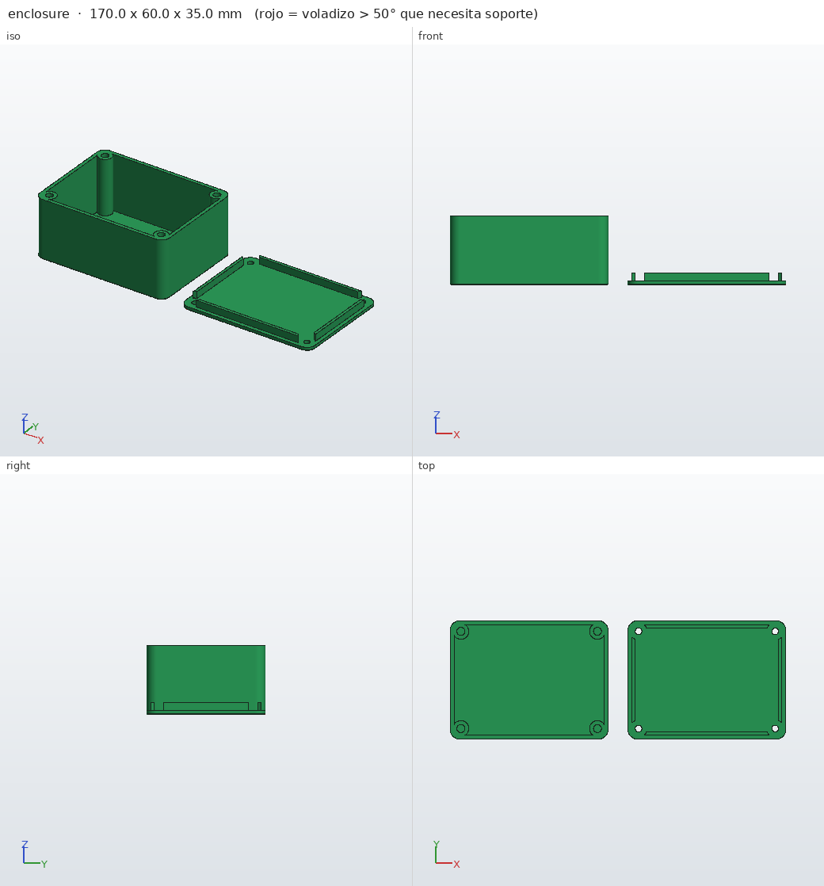
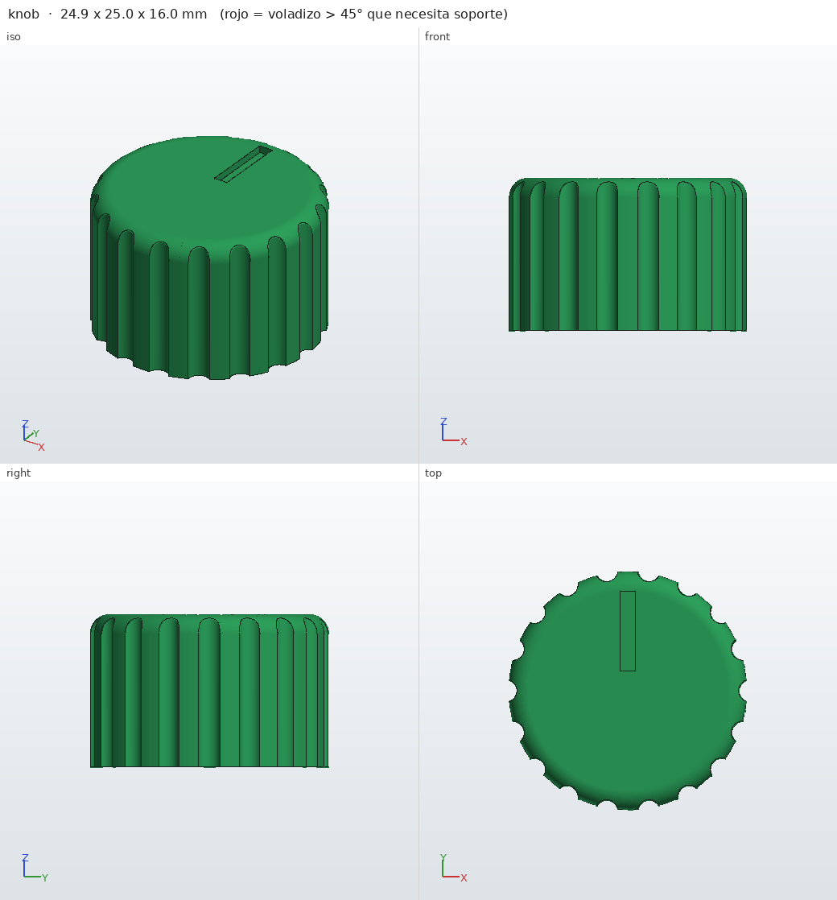
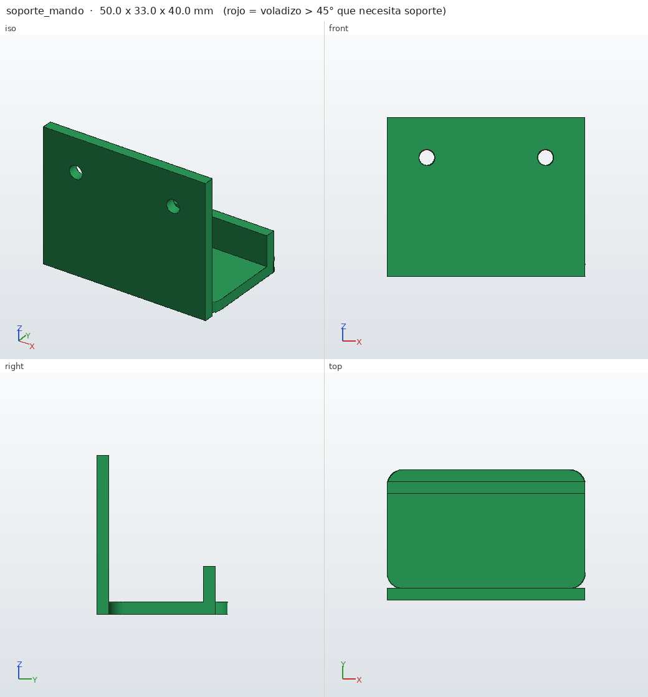

# 🖨️ Bambu CAD MCP: CAD paramétrico para la Bambu Lab P2S

Es un servidor **MCP** que convierte a Claude (u otro cliente MCP) en un ingeniero de diseño que
modela piezas con un **kernel CAD B-rep real (OpenCascade, vía [build123d](https://github.com/gumyr/build123d))**,
comprueba si se pueden imprimir en tu **Bambu Lab P2S** y deja los archivos preparados para Bambu Studio.

Tú describes la pieza ("una caja para un Arduino Nano con tapa a presión y agujeros para USB") y Claude:

1. escribe el modelo paramétrico,
2. lo genera en **STEP + STL + 3MF**,
3. analiza si se puede imprimir: si cabe, voladizos, paredes finas, contacto con la cama, gramos y tiempo,
4. te enseña una **vista previa** con los voladizos marcados en rojo,
5. busca la **mejor orientación** para gastar el mínimo de soportes,
6. y, si quieres, lo **lamina** y lo **manda a la impresora** por LAN.



## ¿Por qué build123d / OpenCascade?

OpenSCAD trabaja con mallas y CSG. OpenCascade, en cambio, es un kernel **B-rep** del mismo tipo que los de
SolidWorks, Fusion 360 o FreeCAD. Eso permite:

- **filetes y chaflanes** de verdad en aristas seleccionadas,
- **vaciados (shell)**, lofts, barridos, revoluciones, texto y booleanas robustas,
- exportar a **STEP**, para seguir editando la pieza en Fusion, FreeCAD u Onshape,
- y modelos **paramétricos** en Python: cambias una variable y se regenera todo.

## Herramientas MCP

| Herramienta | Qué hace |
|---|---|
| `design_guide` | Guía experta: sintaxis build123d, reglas FDM, tolerancias, tornillería, datos de la P2S |
| `materials_guide` | Temperaturas, placa y cámara por material (PLA, PETG, ABS, ASA, TPU, PC, PETG-CF, PA-CF) |
| `create_model` | Ejecuta código build123d → STEP/STL/3MF + informe + vista previa (con historial de versiones) |
| `list_templates` / `create_from_template` | Plantillas paramétricas listas para usar (ver abajo) |
| `get_model_code` | Devuelve el código del modelo para iterar sobre él |
| `import_model` | Importa un STEP/STL/3MF/OBJ que ya tengas (por ejemplo de Printables) |
| `analyze_model` | Informe de imprimibilidad para la P2S |
| `render_model` | Vistas iso/frontal/lateral/superior… (voladizos en rojo) |
| `orient_for_print` | Prueba las posiciones estables y elige la de menos soporte y más contacto con la cama |
| `export_model` | Copia el 3MF / STL / STEP / .py a la carpeta que elijas |
| `open_in_slicer` | Abre el 3MF en Bambu Studio u OrcaSlicer |
| `slice_model` | Lamina con la CLI de Bambu Studio u OrcaSlicer → `.gcode.3mf` |
| `printer_status` / `send_to_printer` / `printer_control` | Control por LAN de la P2S (**experimental**) |

### Plantillas incluidas

`enclosure` (caja con tapa y columnas para insertos M3), `l_bracket` (escuadra con nervio),
`spacer` (separador redondo o hexagonal), `cable_clip`, `phone_stand`, `knob` (pomo para eje en D)
y `tolerance_test` (pieza para calibrar holguras: imprímela primero).

| Pomo moleteado (`knob`) | Modelo libre (`create_model`) |
|---|---|
|  |  |

## Instalación

Necesitas Python 3.10–3.13. Lo más sencillo es usar [uv](https://docs.astral.sh/uv/).

### Claude Desktop

Edita `claude_desktop_config.json` (en macOS: `~/Library/Application Support/Claude/`; en Windows:
`%APPDATA%\Claude\`) y añade lo siguiente (tienes un ejemplo completo en [`examples/claude_desktop_config.json`](examples/claude_desktop_config.json)):

```json
{
  "mcpServers": {
    "bambu-cad": {
      "command": "uvx",
      "args": ["--python", "3.12",
               "--from", "git+https://github.com/carlos-gimeno/carlos-gimeno#subdirectory=bambu-cad-mcp",
               "--with", "paho-mqtt",
               "bambu-cad-mcp"]
    }
  }
}
```

La primera vez tarda un poco porque descarga OpenCascade (unos 100 MB).

### Claude Code

```bash
claude mcp add bambu-cad -- uvx --python 3.12 \
  --from "git+https://github.com/carlos-gimeno/carlos-gimeno#subdirectory=bambu-cad-mcp" \
  --with paho-mqtt bambu-cad-mcp
```

### Instalación local (para desarrollar)

```bash
cd bambu-cad-mcp
python -m venv .venv && source .venv/bin/activate
pip install -e ".[printer,dev]"
pytest                    # 12 tests: plantillas, análisis, orientación, exportación
bambu-cad-mcp             # arranca el servidor por stdio
```

## Variables de entorno

| Variable | Para qué |
|---|---|
| `BAMBU_CAD_WORKSPACE` | Carpeta donde se guardan los modelos (por defecto `~/BambuCAD`) |
| `BAMBU_CAD_TIMEOUT` | Segundos máximos para generar un modelo (por defecto 180) |
| `BAMBU_SLICER_PATH` | Ruta a Bambu Studio u OrcaSlicer si no se detecta sola |
| `BAMBU_PROFILE_MACHINE` / `_PROCESS` / `_FILAMENT` | Perfiles JSON exportados de Bambu Studio para `slice_model` |
| `BAMBU_PRINTER_IP` / `BAMBU_PRINTER_SERIAL` / `BAMBU_ACCESS_CODE` | Conexión LAN con la P2S |
| `BAMBU_CA_CERT` | (Opcional) certificado de la CA de la impresora para verificar TLS |

## Imprimir desde Claude (LAN, experimental)

1. En la P2S ve a **Ajustes → Red** y activa el **modo LAN**. Con el firmware reciente también tienes que
   activar el **modo desarrollador**; sin él, Bambu no deja que herramientas de terceros controlen la impresora.
2. Apunta la **IP**, el **número de serie** y el **código de acceso** de 8 dígitos y ponlos en el bloque `env` de la configuración.
3. Flujo: `slice_model` → `send_to_printer` (Claude te pedirá confirmación antes de imprimir).

El protocolo es el mismo que usa Bambu Studio en LAN: se sube el archivo por FTPS (puerto 990) y se envían
los comandos por MQTT con TLS (puerto 8883). Es la parte que menos se ha probado; la opción más fiable sigue
siendo `open_in_slicer`, revisar el laminado en Bambu Studio y enviarlo desde allí.

> 🔐 La impresora usa un certificado autofirmado, así que por defecto no se verifica TLS (el tráfico se queda
> en tu red local). Si quieres verificarlo, define `BAMBU_CA_CERT`. Las credenciales se leen siempre de variables
> de entorno y nunca se escriben en los logs.

## Ejemplos de lo que puedes pedir

- *"Diséñame una caja para una Raspberry Pi 5 con rejillas de ventilación y huecos para USB y HDMI, en PETG"*
- *"Necesito un adaptador para unir un tubo de 32 mm a otro de 25 mm, estanco"*
- *"Haz una escuadra de 60 mm para una estantería que aguante peso. ¿Qué material y qué relleno uso?"*
- *"Importa ~/Downloads/soporte.stl, dime si necesita soportes y oriéntalo"*
- *"Imprime primero la pieza de tolerancias en PLA y luego ajusta la holgura de la tapa"*

## Cómo funciona

```
Claude ──MCP──▶ server.py ──subproceso──▶ worker.py (build123d/OpenCascade)
                    │                         └─▶ model.step / model.stl / model.3mf
                    ├─▶ analysis.py  (trimesh: voladizos, paredes, orientación, estimaciones)
                    ├─▶ render.py    (rasterizador con z-buffer en numpy, sin GPU)
                    ├─▶ slicer.py    (CLI de Bambu Studio / OrcaSlicer)
                    └─▶ bambu_lan.py (FTPS + MQTT con la P2S)
```

El código CAD se ejecuta en un **proceso aparte** con un tiempo máximo, de modo que un fallo del kernel
o un bucle infinito no tumban el servidor. Si un modelo falla, se conserva la versión anterior.

> ⚠️ `create_model` ejecuta código Python en tu ordenador; ese es el mecanismo del CAD paramétrico.
> Úsalo solo con clientes MCP de confianza.

Las estimaciones de gramos y tiempo son aproximadas. Los datos buenos son los que da Bambu Studio al laminar.

## Licencia

MIT
